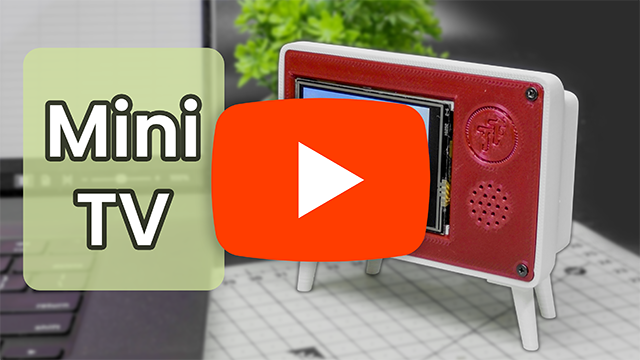

# 🎬 ESP32-S3 Bare-Metal AVI Video Player

A high-performance, bare-metal video player for the ESP32-S3. By dropping heavy UI frameworks (like LVGL) and isolating hardware polling on separate FreeRTOS tasks, this player reclaims ultra-fast internal SRAM to deliver perfectly smooth, tear-free 15-20 FPS video with flawlessly synchronized I2S audio.

Built for the **Tech Talkies** YouTube channel.

### 📺 Watch the Project Video

---

## ✨ Features
* **Bare-Metal Performance:** Operates entirely in the ESP32's internal DMA memory, avoiding slow PSRAM bottlenecks.
* **Flawless A/V Sync:** Fine-tuned I2S DMA buffers (4 descriptors / 512 frames) for zero audio lag.
* **Invisible Touch Zones:** Completely invisible overlay UI for seamless video viewing.
* **Gesture Volume Control:** Swipe up and down to dynamically adjust the software I2S volume multiplier without bulky potentiometers.
* **Background Playlist Scanner:** Automatically detects and queues up to 20 `.avi` files from the SD Card.

---

## ⚡ Quick Install (Web Flasher)
You don't need to compile the code yourself! You can flash the pre-built firmware directly to your ESP32-S3 from your Chrome/Edge browser using WebSerial.

👉 **[Launch the Tech Talkies Web Flasher](https://techtalkies.github.io/flash.html)**

---

## 🎮 Touch Controls (Landscape)
The screen is divided into invisible zones. Tap or swipe directly on the playing video:

| Action | Touch Zone / Gesture |
| :--- | :--- |
| **Play / Pause** | Tap Center-Bottom |
| **Skip 10 Seconds** | Tap Center-Top |
| **Previous Video** | Tap Left Edge |
| **Next Video** | Tap Right Edge |
| **Volume Up** | Swipe Down Anywhere |
| **Volume Down** | Swipe Up Anywhere |
---

## 🎞️ Video Conversion (FFmpeg)
Microcontrollers need highly specific video formats to maintain smooth framerates. We have included an automated Windows Batch script to perfectly optimize your videos.

**Format Specs:** 320x240 resolution, 15 FPS, MJPEG video, PCM 16-bit Mono 16kHz audio.

### How to use the automated converter:
1. Download the Converter and extract it.
2. Place your source videos (`.mp4`, `.mov`, `.mkv`, etc.) into the `Input` folder.
3. Run `convert.bat`.
4. Grab your optimized `.avi` files from the `Output` folder and copy them to the root of your SD Card.

---

## 🛠️ Hardware Requirements
This code was optimized for the **Matouch ESP32-S3 2.4" Display**, but can be adapted for others. 
* **MCU:** ESP32-S3
* **Display Driver:** ST7789 (Connected via SPI)
* **Touch Driver:** NS2009 (Connected via I2C)
* **Audio:** I2S Amplifier (e.g., MAX98357A)
* **Storage:** SD Card (Connected via SDIO/SPI)

---

## ☕ Support the Channel
If this code helped you build something awesome, consider supporting the channel! 

*Don't forget to subscribe to [Tech Talkies on YouTube](https://www.youtube.com/@TechTalkies) for more hardcore microcontroller projects!*
