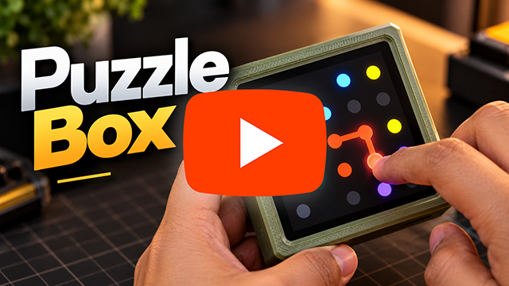

# Puzzle Box 🧩

[](https://ko-fi.com/techtalkies)   

I built this **Puzzle Box** because I wanted a dedicated, immersive, distraction-free handheld console specifically for brain-teasing games. Instead of dealing with clunky buttons or messy interfaces, this project offers a pure, edge-to-edge touch experience with fluid animations and responsive retro sound effects.

The project is built around the [MaTouch 4 inch ESP32 Display.](https://www.makerfabs.com/esp32-s3-parallel-tft-with-touch-4-inch.html)

Use the coupon **TechTalkies-MaTouch4.0** for a $5 discount!

## Full build video
[](https://youtu.be/XO6Na3-kmec)

## Features

- Play 6 classic games: Sliding Tiles, 2048, Flood Fill, Pipes, Connect Dots, and Simon Says.
- Seamless touch UI built with LVGL, featuring custom layouts and icons.
- Immersive "Hidden Pause Menu" accessed by long-pressing the top-right corner.
- Dedicated FreeRTOS audio task pushing generated PCM arrays to an I2S DAC.
- Dynamic procedural level generation that scales in difficulty.
- Global volume control slider built into the home screen.

## Flashing

The firmware can be flashed from the [Tech Talkies Online Flasher.](https://techtalkies.github.io/flash.html)


## ☕ Support Tech Talkies

If you find these projects useful, consider supporting future maker projects.

[](https://ko-fi.com/techtalkies)


## UI Flow

```text
               ┌─────────────┐
               │ Home Screen │◄────────┐
               └──────┬──────┘         │
                      │                │
            Tap Game Icon              │ Exit
                      │                │ Game
                      ▼                │
               ┌─────────────┐         │
     ┌─────────┤ Game Screen ├─────────┘
     │         └──────┬──────┘
  Generate            │
  New Level           │ Long-Press 
     │                │ Top-Right
     │                ▼
     │         ┌─────────────┐
     └─────────┤ Pause Menu  │
               └──────┬──────┘
                      │
                      │ Resume
                      ▼
               ┌─────────────┐
               │ Game Screen │
               └─────────────┘
```

## License

Please give credit back to the Channel or this repo when using the code.

**Watch the build:** https://youtu.be/4IaLCto_N6Y *(Update link)*
