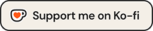
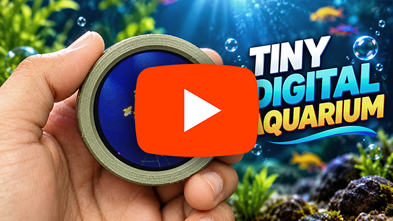

# ESP32 Aquarium

[](https://ko-fi.com/techtalkies)   

An animated aquarium demo for a 240 x 240 GC9A01 round TFT display, built with ESP-IDF and LVGL.

The project combines generated pixel-art sprites, boid-style fish movement, rotating species schools, animated jellyfish and manta rays, bubbles, kelp, and touch interaction.

[](https://ko-fi.com/techtalkies)


## Full build video
[](https://youtu.be/XajTXU7A1yA)

## Features

- 240 x 240 round-display aquarium animation
- LVGL with RGB565 rendering
- Canvas-based fish compositing to reduce per-fish LVGL objects
- Multiple fish species with individual movement and animated frames
- Rotating schools of up to three species
- School-to-school separation with occasional crossing
- Jellyfish that drift upward in spread-out groups
- Slower manta ray behavior with two top-view animation frames
- Natural kelp sway and thin foreground branches
- Swaying bubbles from two simultaneous streams
- Static blue background gradient
- Touch reactions:
  - Fish flee from a held touch
  - Fish orbit around the touch point

## Hardware

- [XIAO ESP32-S3](https://www.seeedstudio.com/Seeed-Studio-XIAO-ESP32S3-Plus-p-6361.html?sensecap_affiliate=P9GHEkF&amp;referring_service=link)
- [Round LCD display](https://www.seeedstudio.com/1-28-Round-Touch-Display-for-Seeed-Studio-XIAO-ESP32.html?sensecap_affiliate=P9GHEkF&amp;referring_service=link)


The firmware is configured for 8 MB flash and ESP32-S3 PSRAM.

 

## Software

- ESP-IDF
- LVGL 8.3.11
- Espressif GC9A01 LCD component
- FreeRTOS

Managed dependencies are listed in [main/idf_component.yml](main/idf_component.yml).

## Project structure

```text
.
├── CMakeLists.txt
├── sdkconfig
├── main/
│   ├── CMakeLists.txt
│   ├── idf_component.yml
│   └── main.c
├── managed_components/
└── build/
```

Main application code and sprite data are in [main/main.c](main/main.c).

## Build

Install ESP-IDF and activate its environment, then run:

```bash
idf.py set-target esp32s3
idf.py build
```

The existing [sdkconfig](sdkconfig) already selects the ESP32-S3 target, RGB565 LVGL color depth, 8 MB flash, and PSRAM.

## Flash

Connect the ESP32-S3 board and replace `PORT` with the serial port used by your device:

```bash
idf.py -p PORT flash monitor
```

To exit the serial monitor, press `Ctrl+]`.

## Use

The aquarium starts automatically after boot.

- Hold or touch the display to influence the fish.
- A touch randomly selects a flee or orbit response.
- Lifting the finger lets the fish return to normal school movement.
- Schools cycle through the available species while maintaining at most three active schools.

## Notes

- LCD orientation, RGB order, and panel inversion are configured near the top of [main/main.c](main/main.c).
- If the displayed colors are incorrect, check `LCD_INVERT_COLOR` and `LCD_RGB_ORDER`.
- If the touch coordinates or touch detection do not match your board, verify the I2C address, SDA/SCL pins, and touch interrupt pin.
