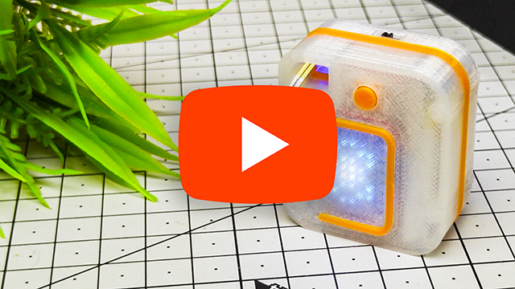
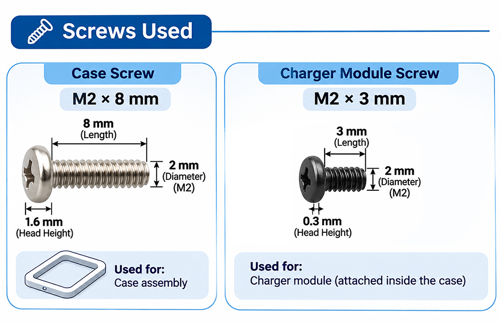
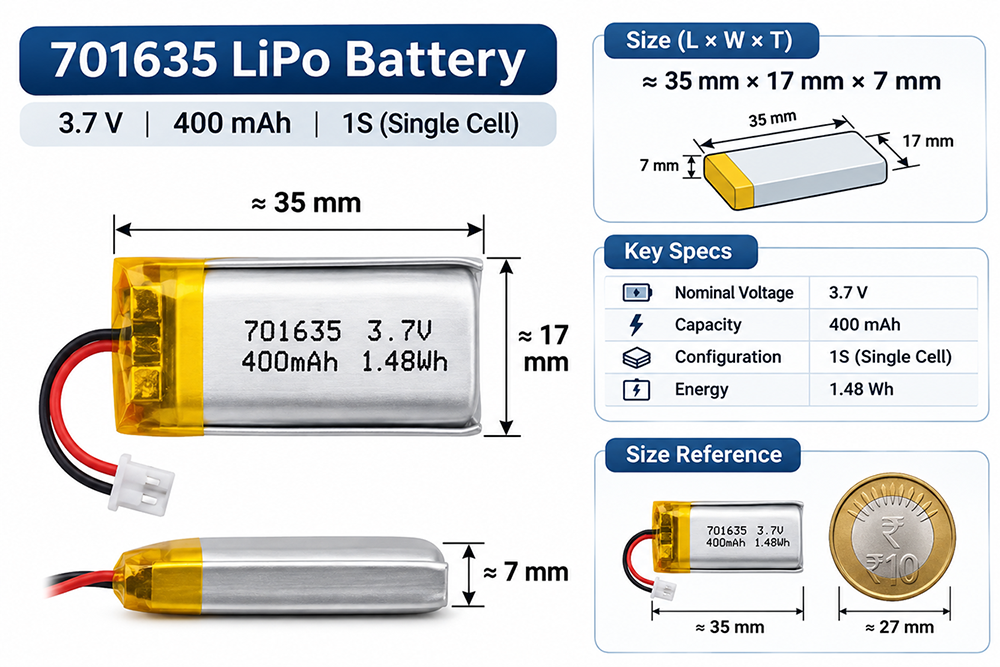
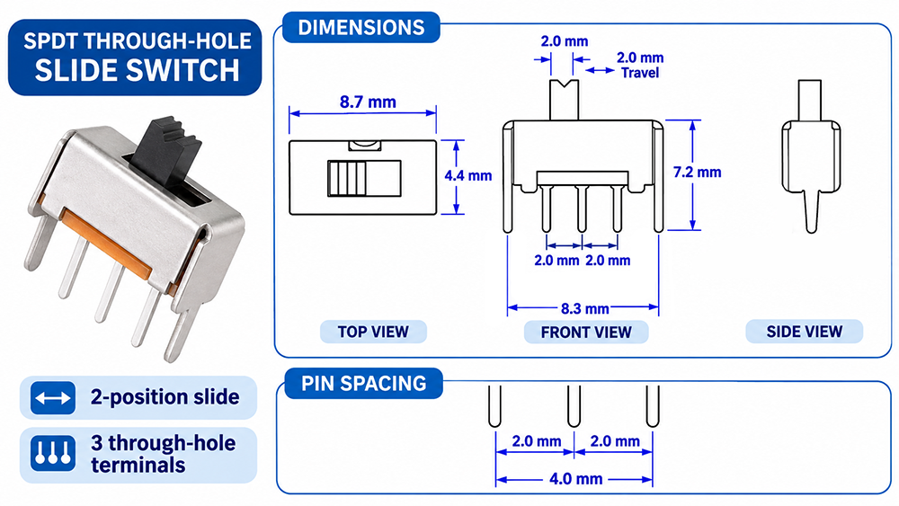
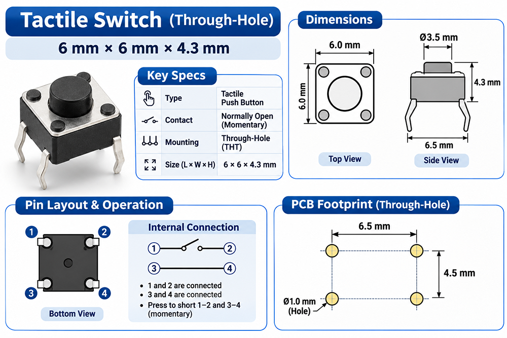

# ESP32 RGB Matrix Keychain️

  

A pocket-sized, fully interactive 6x10 NeoPixel matrix keychain powered by an [ESP32-C3 (Seeed Studio XIAO)](https://www.seeedstudio.com/Seeed-XIAO-ESP32C3-p-5431.html?sensecap_affiliate=P9GHEkF&amp;referring_service=link) and controlled entirely by a single button. 

Despite having only one physical input, this keychain features a dynamic state-machine UI packed with procedural idle animations, classic arcade games, and handy pocket utilities.

## Full build video

## 🌟 Features

### 🕹️ Games & Apps
*   **Stacker:** The classic arcade block-stacking game. Rows get narrower and faster as you build higher.
*   **Micro Tetris:** A miniaturized version of Tetris featuring 1x1, 2x2, and 1x3 blocks with auto-drop and line-clearing physics.
*   **Dino Runner:** An endless runner game. Time your jumps to clear scrolling obstacles.
*   **Pocket Dice:** A chaotic rainbow scramble that snaps to a crisp white 1-6 layout (using chunky 2x2 dots).
*   **Pomodoro/Focus Timer:** A 60-second visual countdown where 60 blue pixels disappear one by one, ending in a red alarm flash.
*   **Text Scroller:** A custom 3x5 minimalist font that scrolls messages (currently hardcoded to "TECH TALKIES") across the matrix.

### 💤 Idle Modes (Screensavers)
When not in an app, the keychain doubles as a desk toy with multiple screensavers:
*   **Pixel Pet:** An expressive digital companion with 2x2 eyes that look around, blink, and a mouth that changes moods. 
*   **Cyberpunk Rain:** Digital green rain cascading down with fading trails.
*   **Pocket Lava Lamp:** Smoothly merging red and orange blobs driven by a lightweight metaball math simulation.
*   **VU Meter:** A 6-band faux audio spectrum equalizer that bounces dynamically. (Not a real VU meter)
*   **Energy:** A pulse of energy constanly pulsing on the display.

## 🕹️ Controls (1-Button UI)

The entire OS is driven by a non-blocking `millis()` state machine on **Pin D2** that measures how long the button is held.

| Action | Duration | What it does |
| :--- | :--- | :--- |
| **Short Tap** | `< 600ms` | Cycle menu, drop block, jump, rotate piece, switch idle mode. |
| **Long Press** | `> 600ms` | **Select App** (from menu) or **Return to Menu** (from any app/idle). |

## 🛠️ Hardware Requirements

*   **Microcontroller:** [Seeed Studio XIAO ESP32-C3](https://www.seeedstudio.com/Seeed-XIAO-ESP32C3-p-5431.html?sensecap_affiliate=P9GHEkF&amp;referring_service=link).
*   **Display:** [RGB Matrix for Xiao](https://www.seeedstudio.com/6x10-RGB-MATRIX-for-XIAO-p-5771.html?sensecap_affiliate=P9GHEkF&amp;referring_service=link).
*   **Input:** 1x Tactile Push Button.
*   **Power:** Small 3.7V LiPo Battery.

### Wiring
*   **NeoPixel Data In:** Pin `D0`
*   **Button:** Pin `D2` (wired to GND, uses internal pull-up)
*   **Power:** 3V3/5V and GND

## 💻 Software Setup

Flash from the[ Tech Talkies Flasher Page.](https://techtalkies.github.io/flash.html)

# Size Guides

## License

Please give credit back to the Channel or this repo when using the code.

---
YouTube: https://www.youtube.com/@techtalkies1
